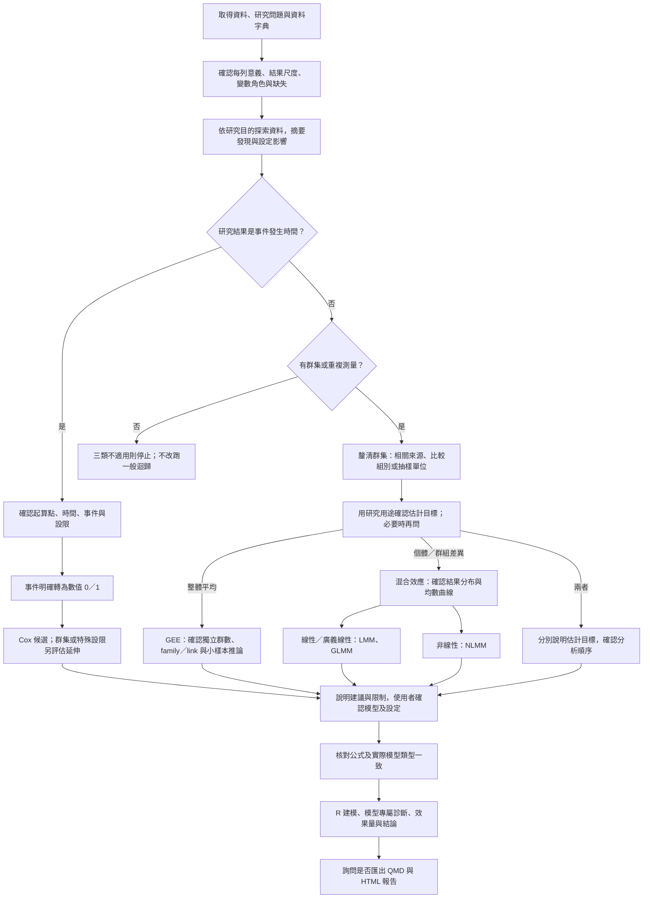

# 候選模型判斷規則

本檔用於收到資料後、提出模型建議前。若只啟動 Skill，先請使用者提供資料、分析目的與變數說明；收到後先核對，不足再追問。流程圖是規則的視覺摘要；必要語意缺少時先詢問，不自動猜測。

建議模型前依 `eda.md` 完成相關的資料探索；語意不足只做可判讀的摘要，不猜測編碼。

## 必須先問的事項
- 事件時間：哪個是事件？0／1 定義是否已確認？起算點、時間單位與設限機制為何？其他編碼先確認再轉換。
- 群集資料：id、訪視時間與群集層級；主要關心個人／群組差異還是母體平均？兩者都關心時確認順序。已有明確答案不重問；不懂術語時先以用途與例子協助，資訊足夠後提出建議並等待確認。
- 混合效應：連續結果且條件均數對參數線性可考慮 LMM；二元／計數等依 family/link 可考慮 GLMM；有科學依據、對參數非線性的連續曲線可考慮 NLMM。三者不能只靠常態檢定或圖形是否彎曲區分。NLMM 需確認函數、參數、起始值與隨機參數。
- 缺失或關鍵語意不清楚：可先摘要，對相依的選模與建模步驟停下澄清。

## 不可越過的邊界
群集事件時間不直接進一般獨立 Cox；先評估 cluster robust／frailty 等延伸。沒有適用群集／隨機效果等結構的普通橫斷資料可能只需一般回歸；此時停止，不在本 Skill 配適該模型。結果分布與均數曲線判斷後仍須參照 `models.md` 的條件與診斷；不以最低 p 值替代研究目標。

混合效應判斷同時看條件分布與對參數的線性／非線性；GLMM 也可含連續 Gamma。GEE 先數獨立群而非列數，少群讀 `small-sample-gee.md`，評估修正或僅探索，不設定 30 群為硬性適用門檻。

少群推論可評估已新增的 fit_gee_md 受限路徑；先讀 small-sample-gee.md，確認 independence、family、資料與自由度，不自動替所有設計套用。

## 協助使用者選目標
### 重複測量與群集資料有什麼不同？

| 資料結構 | 每列代表什麼？ | 例子與相關來源 |
|---|---|---|
| 重複測量 | 同一對象在不同時間或條件下的一次觀測 | 追蹤 20 位病人，每人每月測血壓；同一人的多次血壓可能相關 |
| 群集資料 | 同一群組中不同對象的一筆觀測 | 10 個班級，每班多位學生各測一次成績；同班學生因共同環境而可能相關 |
| 兩者同時存在 | 群組中的對象再被重複觀測 | 多家醫院的病人各自追蹤多次；可能同時有醫院與病人內相關 |

兩者不是互斥：廣義而言，重複測量也可視為「以個人為群集」。這裡為了方便理解，區分同一人多次觀測與同群不同人的資料；要確認 id、時間與群集層級，不能把列數當獨立樣本數。

### 不知道要選「個別差異」還是「整體平均」怎麼辦？

不用先理解模型術語，先問想用結果回答什麼：

- 「想估每位病人的變化曲線，或了解醫院／班級之間有多大差異？」→ 可優先考慮混合效應。
- 「想知道整體病人中，治療或暴露與平均結果有何關聯？」→ 可優先考慮 GEE。
- 仍不確定 → 先了解分析用途、主要比較與是否需要個別預測，再由 AI 提出理由清楚的建議，讓使用者確認。

**資料結構決定哪些分析可行，研究目的決定主要回答什麼。**同一份資料可能兩者都適用，不能只看欄位就唯一判定。群數、量測次數、缺失與模型假設也要納入評估；混合模型也能描述共同趨勢，並非只能研究個人。

### 混合效應：先分線性與非線性兩個方向

| 方向 | 適用想法與例子 | 後續設定 |
|---|---|---|
| **線性／廣義線性混合效應（LMM、GLMM）** | 描述解釋變數與結果的關聯，並考慮個人／群組差異。例如血壓變化、是否發病、發作次數 | 連續結果可評估 LMM；二元、計數或其他分布依情況採 GLMM |
| **非線性混合效應（NLMM）** | 有特定成長或衰減曲線。例如估計不同樹木的生長上限 | 確認曲線、參數意義、起始值與隨機效果 |

LMM 與 GLMM 在此放同一分支：GLMM 的線性預測式再透過連結函數對應結果，不表示原始結果一定呈直線。圖形彎曲也不代表一定需要 NLMM。

## 群集角色與防止誤判
有群集線索必讀 `cluster-roles.md`。不用等使用者說出「相關性」，也不因欄名 cluster 就斷定 GLMM。先確認群集形成方式、每群多列、群數、比較目標與抽樣設計；「比較群集」不是指定固定效果。群集差異／條件關聯可評估混合效應，整體平均可評估 GEE，具名群對參考群則需另外辨認估計量及相關性處理。
使用者不確定時用用途澄清、回述計畫再確認，不能誘導其選範圍外模型。若需要設計式複雜抽樣分析或普通 logistic，說明理由並停止；不把「探索性」當作範圍外分析的通行證。
